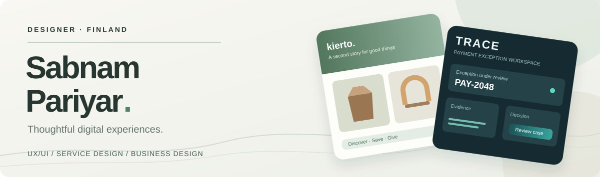
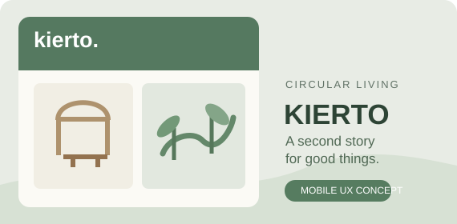
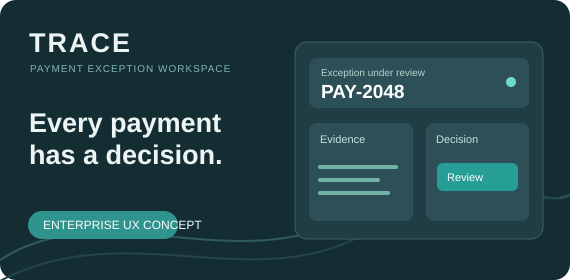

  

  
<strong>UX/UI · Service design · Sustainable digital experiences</strong>

  
Designer at <strong>Ronix Tieto</strong> · Freelance designer · Finland

  
Bachelor's in Business Design, <strong>LAB University of Applied Sciences</strong> — ongoing

  
  
<a href="#my-approach">My approach</a> &nbsp;·&nbsp; <a href="#what-i-work-with">Design focus</a>

---

### Hello, I'm Sabnam.

I design digital experiences that feel **clear, considered, and useful**.

My work brings together human-centred UX, information design, service thinking, and sustainability. At **Ronix Tieto** and through freelance design work, I explore how thoughtful interfaces can make complicated information easier to understand and everyday tasks feel more natural.

I'm currently studying for a **Bachelor's degree in Business Design at LAB University of Applied Sciences** in Finland. I care about the whole experience: understanding a problem, shaping a journey, choosing a visual direction, and thinking carefully about what should happen when something goes wrong.

## Selected work

<table>
  <tr>
    <td width="50%" valign="top">
      
      
<strong>KIERTO — Good things deserve a second story.</strong>

      
A calm, mobile-first experience for discovering and passing on secondhand essentials in a local student community. An exploration of circular living, trust, and simple everyday interactions.

      

        
        
      

    </td>
    <td width="50%" valign="top">
      
      
<strong>TRACE — Every payment has a decision.</strong>

      
An enterprise UX concept for investigating payment exceptions. I explored how evidence, clear system states, role-based actions, and a traceable decision history can support confident work.

      

        
        
      

    </td>
  </tr>
</table>

Both are independent portfolio concepts with illustrative content, not commissioned products or live customer systems. My case studies focus on the design problem, the experience, and the decisions behind it.

## My approach

| 01 · Understand | 02 · Structure | 03 · Make | 04 · Learn |
| :--- | :--- | :--- | :--- |
| Frame the problem and users' needs | Map journeys, information, and edge cases | Prototype interactions and visual systems | Test assumptions and refine the experience |

I like design that explains itself without shouting: readable typography, meaningful color, thoughtful components, and clear feedback when someone needs to make a decision.

## What I work with

**UX & product thinking** · User journeys · Information architecture · Interaction design · Wireframing · Prototyping

**Visual & service design** · Figma · Design systems · Accessibility-aware interfaces · Service design · Circular-economy concepts

**Research & collaboration** · Research synthesis · Information design · Design documentation · Cross-disciplinary teamwork

---

  
<strong>Good design helps people understand what matters and what to do next.</strong>

  
Sabnam Pariyar · Finland · Ronix Tieto / Freelance Design

